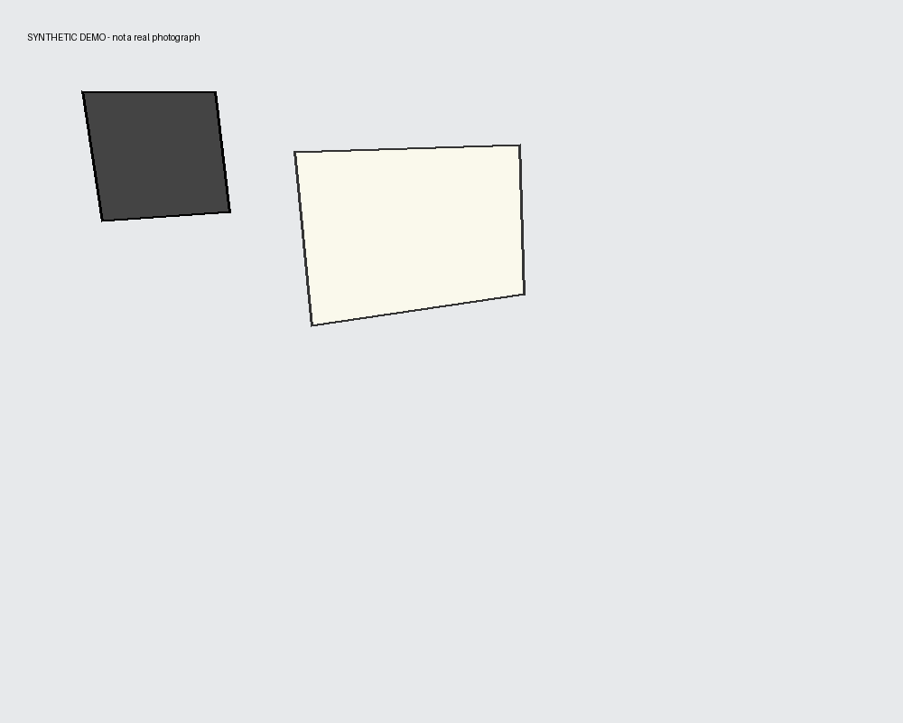

# PhotoMeasure

**Estimate a flat rectangular object's dimensions from a single photograph.**

A local Python/OpenCV portfolio prototype estimating two side dimensions of a
flat rectangular object from one photograph and a measured square reference.
This is a personal project, not an employer integration. Supported objects are
paper, photos and thin cards on the same flat plane as the reference.

## Features

- Manual corner selection with click, drag, numeric editing, undo, and reset.
- Planar perspective correction with validated homography geometry.
- ArUco reference detection and printable `DICT_4X4_50` markers.
- Assisted contour suggestions with explicit selection, correction, and confirmation.
- Annotated and rectified previews, PNG/CSV/JSON exports, and reusable annotations.
- Optional ruler ground truth, dimension errors, and manifest-driven evaluation.

Images are processed locally. No cloud API, account, GPU, trained model, or frontend
build service is required.

## Synthetic preview



*Generated example, not a real photograph. The reference side is 50 mm; the target
is 80 × 120 mm. Exact saved coordinates recover these dimensions. Raster clicking
introduces selection error.*

## Install and launch

Use Python 3.11 to reproduce the tested environment. The application targets
Python 3.11+, but the pinned environment was verified on Python 3.11.9 on Windows.
Start in the repository root.

### Windows / PowerShell

```powershell
python -m venv .venv
.venv\Scripts\python -m pip install -r requirements-lock.txt
.venv\Scripts\python -m streamlit run app.py --server.address 127.0.0.1
```

### macOS / Linux

```bash
python3.11 -m venv .venv
.venv/bin/python -m pip install -r requirements-lock.txt
.venv/bin/python -m streamlit run app.py --server.address 127.0.0.1
```

Open [http://127.0.0.1:8501](http://127.0.0.1:8501) in your browser. The bundled
configuration binds the server to localhost and uses a light theme.

requirements.txt pins the direct dependencies; requirements-lock.txt records the
complete tested environment. Use a fresh environment with only
opencv-contrib-python-headless, avoiding competing OpenCV distributions.
The annotation component is bundled; no Node build or external CDN is needed.

## Tests and verification

The integrated suite passed **88 tests** on 2026-10-14. It covers independent
perspective geometry, coordinate scaling, corner ordering, units, image validation,
exports, synthetic detection, stale state, controlled app workflows, and evaluation
integrity. Synthetic success does not establish real-photo accuracy.

```powershell
.venv\Scripts\python -m pytest -q
.venv\Scripts\python -m pip check
```

The remaining commands use Windows paths. On macOS/Linux replace
`.venv\Scripts\python` with `.venv/bin/python`. See the
[verification record](docs/verification.md) for test scope and manual checks.

## Five-minute demonstration

Generate the clearly labeled synthetic example:

```powershell
.venv\Scripts\python scripts/generate_synthetic.py
.venv\Scripts\python scripts/run_evaluation.py --manifest examples/synthetic_manifest.csv --output evaluation/results/synthetic_smoke --data-kind synthetic --hardware "Your laptop description"
```

1. Launch the app, upload the generated PNG, and leave the analysis edge at 2000.
2. Select four reference corners sequentially around its perimeter and enter
   its known 50 mm synthetic side. Confirm the reference; this example is not a photo.
3. Select and confirm four target corners. Drag a point to correct it or use
   numeric editing; try undo/reset. Click Measure. Exact saved synthetic corners
   give 8.0 × 12.0 cm; raster clicking may differ.
4. Inspect the short/long estimates in cm, warnings, annotated image, and
   rectified scale bar. Download PNG, full JSON, CSV and reusable annotation.
5. Change a corner or upload a different image. Results must clear and require
   confirmation again. Repeat with your own supported photo and actual ruler
   reference size. Browser resizing must keep selections aligned.

For real photos, the reference suggestion of 50 mm must be verified with a
ruler. Both surfaces must be flat and coplanar. Results are estimates; stored
decimal places do not imply physical precision.

## Marker printing and assisted selection

```powershell
.venv\Scripts\python scripts/generate_marker.py --output marker.svg
```

The DICT_4X4_50 ID 0 marker has a white quiet zone. Print at actual size with
fit-to-page disabled. Its intended outer black-square side is 50 mm; the quiet
zone is additional. Measure the black square with a ruler and enter that actual
size. Choose a detected marker explicitly when multiple are present. Confirm
target candidates and edit corners as necessary; manual fallback is always
available. Contours suggest quadrilaterals, not recognized objects.
An already generated [printable SVG](examples/marker.svg) is included.

## Evaluation with your photographs

No real-photo dataset or accuracy results are included. Copy
evaluation/manifest_example.csv, replace every placeholder with observed data,
and save annotation JSON for each image using the app. Keep private images in
private_photos/ and annotations in evaluation/annotations/. Private photos,
local manifests, annotations, and generated results in these locations are ignored
by Git. Paths in the manifest are relative to the manifest directory.

```powershell
.venv\Scripts\python scripts/run_evaluation.py --manifest evaluation/my_manifest.csv --output evaluation/results/my_run --hardware "Describe your laptop and camera"
```

See [the protocol](docs/evaluation_protocol.md) for object-separated development
and evaluation subsets, detector correction/fallback records, latency timing,
failed-case retention, and interpreting a small experiment. The runner produces
per-photo CSV, full JSON, summary, figures and a failure report. It never fills
missing data with invented observations or exports private images automatically.

| Output | Contents |
| --- | --- |
| `per_photo.csv` | Measurements, errors, conditions, and retained failures |
| `results.json` | Full records and metadata |
| `summary.json` | Separate dimension/method/split metrics and processing latency |
| `error_by_angle_category.png` | Dimension error grouped by angle |
| `error_by_lighting.png` | Dimension error grouped by lighting |
| `failures.md` | Failed rows and reasons; no private images copied |

Missing detection evidence produces undefined rates with explicit unknown counts.
Failures remain in the report and are excluded from dimension-error aggregates.
Timing excludes upload, rendering, and human work, with a warm-up per method.

## Repository layout

```text
app.py                  Streamlit workflow
photomeasure/           Loading, geometry, detection, rendering, exports, evaluation
components/             Bundled corner annotation component
scripts/                Marker/demo generation and batch evaluation
tests/                  Independent geometry and application tests
examples/               Labeled synthetic assets and printable marker
evaluation/             Placeholder manifest and local result directories
docs/                   Architecture, mathematics, schemas, protocol, limitations
```

## How measurement works

Four square-reference corners define a planar homography from image pixels
to millimetres. Applying it to the target's four corners corrects perspective.
Distances between transformed corners yield four sides; opposite pairs are
averaged and sorted into short and long. A global pixel scale is inadequate
for tilted photos. Read the beginner-friendly [measurement notes](docs/measurement_method.md),
[architecture](docs/architecture.md), [interfaces/schema](docs/interfaces.md),
[limitations](docs/limitations.md), and [verification record](docs/verification.md).
The [milestone handoff](docs/milestones.md) lists completed checks and manual follow-up.
The [detection notes](docs/detection.md) explain candidate filtering and ranking.
The original [project specification](PROJECT_SPEC.md) records the bounded scope.

Lens distortion, noncoplanar objects, thick/curved objects, tiny or distant
references, blur and wide-angle lenses can cause error. Prefer the main phone
camera, keep the marker near the object, and avoid image edges. A ruler supplies
real-photo ground truth, with its own reading uncertainty. Synthetic success
only verifies the implementation; numerical portfolio claims await real runs.
